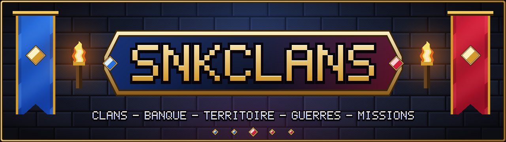
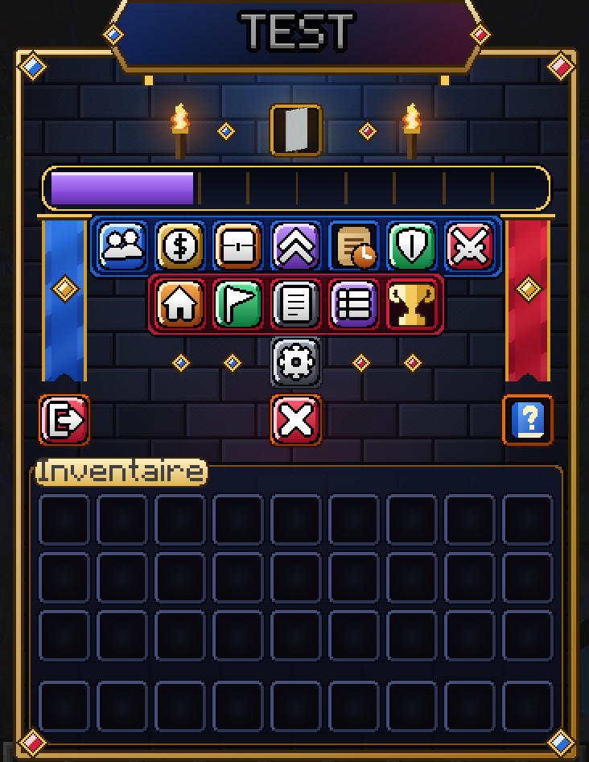
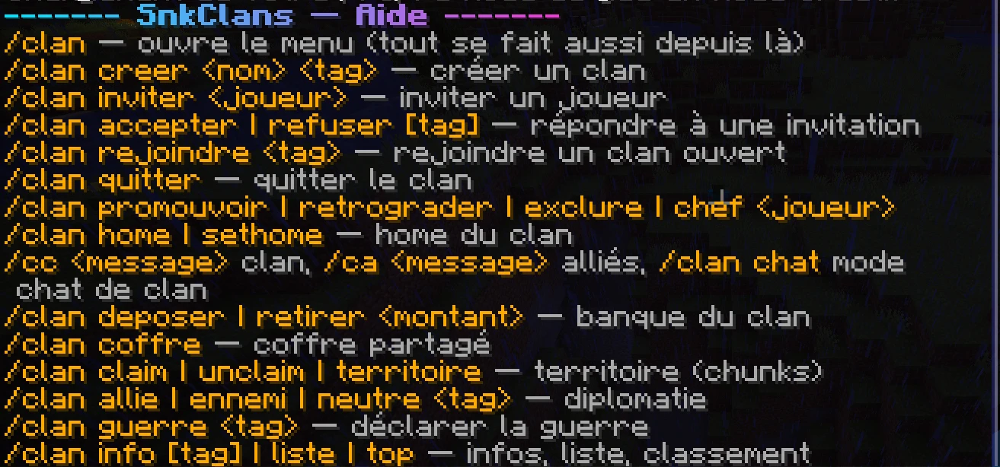

<b>Des clans complets : banque, coffre partagé, territoire, alliances, guerres et missions.</b> 
Plugin Minecraft pour serveurs <b>Paper 1.21.4 à 26.3</b>, par <b>SnkAlex</b>.

<a href="#-fonctions">Fonctions</a> •
<a href="#-captures">Captures</a> •
<a href="#-commandes">Commandes</a> •
<a href="#-compatibilité">Compatibilité</a> •
<a href="#-lobtenir">L'obtenir</a>

---

## ✨ Fonctions

### 👥 Le clan
- Création avec un nom et un **tag coloré** dans le chat et la liste des joueurs
- **4 grades** : Chef, Officier, Membre, Recrue
- **12 permissions** à régler pour chaque grade, directement dans le menu
- Invitations, recrutement ouvert ou fermé, bannière, description, home
- **Chat de clan** et chat d'alliance

### 📈 Les niveaux
- **50 niveaux** : le clan gagne de l'XP en tuant des monstres, en combattant, en jouant et en réussissant des missions
- Les niveaux débloquent des couleurs de tag et des **améliorations** : plus de membres, de coffre, de territoire et d'XP

### 🏦 La banque et le coffre
- Banque commune avec historique (Vault)
- **Coffre partagé** de 1 à 5 pages, avec un journal : qui a pris quoi, et quand

### 🚩 Le territoire
- Le clan achète des chunks et les protège : blocs, coffres, portes, animaux, explosions, feu...
- Protégé aussi contre les **pistons, les liquides et les distributeurs** venant de l'extérieur
- Les bords s'affichent en particules

### ⚔️ Alliances et guerres
- Alliés, ennemis et demandes d'alliance
- **Guerres** avec score, temps restant, bilan et récompense
- **Classement** des clans

### 📜 Les missions
- **3 missions par semaine** pour tout le clan, avec XP et argent à gagner

### 🎨 Des menus dessinés
14 menus avec leur propre interface grâce à un pack de ressources fourni. Les joueurs qui n'ont pas le pack voient des menus classiques. Les textes des messages se changent dans un fichier.

---

## 📸 Captures

 Le menu du clan : tout se fait depuis là

 L'aide en jeu

---

## ⌨️ Commandes

| Commande | Effet |
|---|---|
| `/clan` | Ouvre le menu (tout se fait aussi depuis là) |
| `/clan creer <nom> <tag>` | Crée un clan |
| `/clan inviter <joueur>` | Invite un joueur |
| `/clan accepter` · `refuser [tag]` | Répond à une invitation |
| `/clan rejoindre <tag>` · `quitter` | Rejoint un clan ouvert · quitte le clan |
| `/clan promouvoir` · `retrograder` · `exclure` · `chef <joueur>` | Gère les membres |
| `/clan home` · `sethome` | Home du clan |
| `/cc <message>` · `/ca <message>` | Chat de clan · chat d'alliance |
| `/clan deposer` · `retirer <montant>` | Banque du clan |
| `/clan coffre` | Coffre partagé |
| `/clan claim` · `unclaim` · `territoire` | Territoire |
| `/clan allie` · `ennemi` · `neutre <tag>` | Diplomatie |
| `/clan guerre <tag>` | Déclare la guerre |
| `/clan info [tag]` · `liste` · `top` | Infos, liste, classement |
| `/clan admin ...` | Recharger, supprimer un clan, régler XP, banque et niveau (admin) |

**Permissions :** `snkclans.admin` (admin), `snkclans.admin.bypass` (construire partout).

<b>Placeholders (PlaceholderAPI)</b>

`%snkclans_tag%` `%snkclans_tag_brut%` `%snkclans_nom%` `%snkclans_niveau%` `%snkclans_grade%` `%snkclans_membres%` `%snkclans_en_ligne%` `%snkclans_banque%` `%snkclans_kills%` `%snkclans_puissance%` `%snkclans_a_un_clan%`

---

## 🧩 Compatibilité

| | |
|---|---|
| **Versions** | 1.21.4 à 26.3, un seul fichier pour toutes |
| **Testé sur** | Paper 1.21.4, 1.21.11, 26.2 et 26.3 |
| **Serveur** | Paper |
| **Java** | 21 ou plus (celui de ta version de Paper) |
| **Conseillé** | Vault et une économie (EssentialsX, SnkMetiers...) pour la banque et les prix |
| **Facultatif** | PlaceholderAPI |
| **Sauvegarde** | SQLite, en arrière-plan, rien à installer |

**Va plus loin avec les autres plugins Snk** (facultatifs) :
- **[SnkMarche](https://github.com/SnkStudio/SnkMarche)** : réduction de clan à la boutique, et une part de la taxe de l'hôtel des ventes va à la banque du clan
- **[SnkMetiers](https://github.com/SnkStudio/SnkMetiers)** : l'XP de métier des membres fait monter le clan

---

## 📦 Ce que tu reçois
- Le plugin (`.jar`)
- Le pack de ressources des menus
- Le guide d'installation et le guide complet, en français

Aucune connaissance en code n'est nécessaire : tout se règle dans deux fichiers.

---

## 📩 L'obtenir

Le plugin n'est pas en téléchargement libre. Pour le prix, une question ou une démonstration :

➡️ **[Écris-moi ici](../../issues/new/choose)** (il faut un compte GitHub, c'est gratuit)

> Les messages sont **publics** : n'écris ni adresse e-mail, ni mot de passe, ni information de paiement. On passe ensuite en privé.

---

© SnkAlex. Tous droits réservés. Voir <a href="LICENSE.md">la licence</a>. 
Ce plugin n'est pas un produit officiel Minecraft. Il n'est ni approuvé par Mojang ou Microsoft, ni associé à eux.

